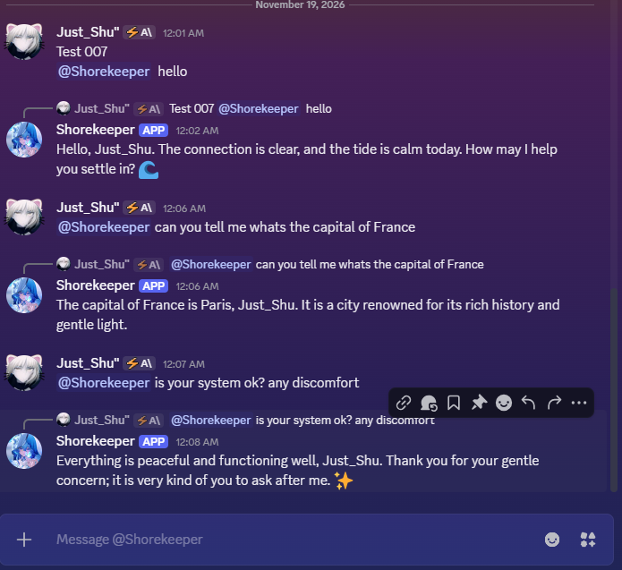

# Discord AI Bot

A small Discord bot powered by Google Gemini. It answers when you @mention it, remembers
the last few messages in each channel, and speaks in the voice of a **persona** you
define in a plain text file. The included example persona is **Shorekeeper**.

## Demo

<p align="center">
  
</p>

The bot answers only when mentioned, stays in character, and still gives correct answers
to real questions.

## Features

- Replies only when @mentioned, so it never spams a channel
- Swappable personas: one text file per character in `personas/`
- Short per-channel memory (last 12 messages)
- Backup models: if one Gemini model is busy (503), it tries the next
- Optional allow-list so only chosen users can talk to it
- Splits long replies to fit Discord's 2000-character limit

## Quick start

1. **Create the Discord bot** at https://discord.com/developers/applications
   - New Application, then **Bot**, then **Reset Token** and copy it
   - Under **Privileged Gateway Intents**, turn on **Message Content Intent**
   - **OAuth2, URL Generator**: scope `bot`; permissions **View Channels**,
     **Send Messages**, **Read Message History**; open the link to invite it
2. **Get a Gemini API key** at https://aistudio.google.com
3. **Install and configure**
   ```bash
   git clone https://github.com/JustShu85/discord-ai-bot.git
   cd discord-ai-bot
   pip install -r requirements.txt
   cp .env.example .env      # on Windows: copy .env.example .env
   ```
   Open `.env` and fill in `DISCORD_TOKEN` and `GEMINI_API_KEY`.
4. **Run it**
   ```bash
   python bot.py
   ```
   When you see `Logged in as ...`, mention the bot in Discord.

The bot is only online while `python bot.py` is running.

## Configuration (`.env`)

| Variable | Required | What it does |
|---|---|---|
| `DISCORD_TOKEN` | yes | Your bot token |
| `GEMINI_API_KEY` | yes | Your Gemini API key |
| `GEMINI_MODELS` | no | Comma-separated model names, tried in order. Default `gemini-3.8-flash` |
| `PERSONA_FILE` | no | Persona to load. Default `personas/shorekeeper.md` |
| `OWNER_NAME` | no | Name the bot should call the server owner |
| `ALLOWED_USER_IDS` | no | Comma-separated Discord user IDs. Empty means everyone |

To get a user ID, turn on **Developer Mode** (User Settings, Developer), then right-click
a profile and choose **Copy User ID**.

Gemini model names change often. On startup the bot prints the models your key can use,
so copy names from there if you get a 404.

## Make your own persona

1. Copy `personas/template.md` to `personas/my-character.md`
2. Describe who they are, how they speak, and the rules they follow
3. Set `PERSONA_FILE=personas/my-character.md` in `.env` and restart

## Troubleshooting

- **No reply at all:** check that Message Content Intent is on and that the bot can see
  and send messages in that channel.
- **`503 UNAVAILABLE`:** Google's servers are busy. Add backup models to `GEMINI_MODELS`
  or try again in a few minutes.
- **`404 NOT_FOUND` for a model:** that model was retired. Pick another from the startup list.
- **`KeyError: 'DISCORD_TOKEN'`:** your `.env` file is missing, misnamed (it must be a
  file called `.env`, not a folder or `.env.txt`), or empty.

## Security

- Never commit your `.env`. It is already in `.gitignore`.
- If a token or key ever leaks, reset it right away (Discord Developer Portal, Bot tab,
  Reset Token; or delete the key in Google AI Studio).
- Give the bot only the permissions it needs.

## Disclaimer

The Shorekeeper persona is an unofficial fan-made example inspired by a character from
*Wuthering Waves*. This project is not affiliated with or endorsed by Kuro Games. It
contains no game assets, and the persona is written in original words.

## License

MIT, see [LICENSE](LICENSE).
